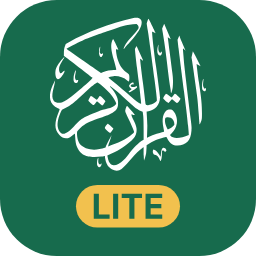

<p align="center">&nbsp;&nbsp;&nbsp;</p>

# Quran

An Android app for reading the Qur'an in the **Uthmani script of the Madani mushaf**, matching the 604-page, 15-line
King Fahd Complex edition, with optional tajweed colouring. Choose **Quran Full** for translations and additional
reading tools, or **Quran Lite** for a focused mushaf-reading experience. Both editions share the same page rendering.

[](https://ko-fi.com/zakkyhidayat)

## Download

<p align="center">
  <a href="https://github.com/zakkyhidayat/quran/releases/latest/download/Quran.apk"></a>
  &nbsp;
  <a href="https://github.com/zakkyhidayat/quran/releases/latest/download/Quran-Lite.apk"></a>
</p>

| Edition | Includes |
|---------|----------|
| **Quran Full** | The complete reading app; see [features](#quran-full-features) below. |
| **Quran Lite** | A focused mushaf reader with page/ayah bookmarks and no translations, search, home content, or thematic browsing. |

Both are separate apps and can be installed side by side. Quran Lite has its own package ID (`io.zakkyhidayat.quran.lite`)
and icon. See [docs/FORK_LITE.md](docs/FORK_LITE.md) for a detailed comparison.

**How to install (Android 8 or newer):**

1. Tap one of the buttons above on your phone. The APK file downloads.
2. Open the downloaded file. If Android asks, allow your browser or file manager to **install unknown apps**.
3. Tap **Install**.

Neither app updates itself: download the new APK from the same button and install over the existing app. Bookmarks and
settings are kept. On first launch, choose a language; Quran Full also offers translation and appearance setup.

All versions and release notes:
[releases page](https://github.com/zakkyhidayat/quran/releases).

## Shared details

- First-run setup downloads the Qur'an database and all 604 page fonts from the stable `quran-data` release; these are
  not bundled in the APK. Reading works offline after setup. Data can be updated or downloaded again from Settings.
- Bookmarks and settings can be exported to a file. Both editions can share a backup folder for bookmarks and reading
  position; automatic backup keeps up to three snapshots. Use Android's file picker to choose local or cloud storage.
- Interface in 10 languages: English, Indonesian, Arabic, Urdu, Bengali, Turkish, Persian, Malay, French, and Russian.
- Screen readers announce each ayah as Unicode Arabic text.
- No ads, account, or tracking. Internet is used for required setup, optional data updates, and Full translation downloads.

## Quran Full features

- Reading modes: fixed mushaf page, ayahs with translation, or translation only; tajweed colours can be toggled.
- Tap an ayah to view translations with footnotes, transliteration, and its juz, hizb, rub', manzil, ruku, and sajdah
  positions. Ayah actions include bookmark, copy, and share.
- Search by Arabic text, translation, surah name, or reference; navigate by surah and divisions, go to an ayah, or open
  a random ayah.
- Home features: ayah of the day, Sunnah readings with hadith, reading history, and ayah collections.
- Thematic tools: topics, ayah themes, similar ayahs, mutashabihat, and word roots, lemmas, and stems.
- Optional daily reading reminders by juz, hizb, or manzil.
- Light, dark, and AMOLED themes; dynamic colour (Android 12+) or original palette; three contrast levels.
- Translation packs are downloaded on demand in many languages, including Indonesian and English; none are bundled in
  the APK.

## Who it is for

This app focuses on one way of reading, done carefully: the Madani mushaf printed by the King Fahd Glorious Quran Printing
Complex (KFGQPC). If that is the mushaf you read, memorise from, or want to get used to, this app is made for you.

This app focuses on the Madani mushaf in Hafs 'an 'Asim. Other valid mushaf layouts and scripts include traditions
such as **IndoPak** or **Shamarly**. Page layouts differ in script, line breaks, and page count; recitation traditions
such as Warsh and Qalun are a separate distinction. This app currently supports only the **KFGQPC V4 Madani layout**.

Choices made on purpose:

| Area | Choice | Why |
|------|--------|-----|
| Script | Uthmani, KFGQPC V4 (Madani) | The most widely printed mushaf; word glyphs match the printed page exactly |
| Riwayah | Hafs 'an 'Asim | The riwayah of the standard Madani mushaf |
| Layout | 604 fixed pages, 15 lines | Memorisation relies on where an ayah sits on the page, so text never reflows |
| Tajweed | V4 font colours (can be turned off) | Same colour source as the printed tajweed mushaf |
| Page style | One style only | Fewer settings, a consistent page |

## Roadmap

- [ ] Word-by-word meaning (tap a word to see its translation)
- [ ] Audio recitation
- [ ] Parts of speech per word (the QUL source page returns an error, schema unknown)

Bug reports and suggestions: [GitHub Issues](https://github.com/zakkyhidayat/quran/issues).

### Known issues

- Page turns sometimes lose their animation: the page shrinks slightly and then disappears instead of sliding. Likely
  caused by one of the rendering optimisations.

## Data, credits, and licence

All Qur'an data comes from the [Quranic Universal Library (QUL)](https://qul.tarteel.ai) by Tarteel. As the
[QUL credits page](https://qul.tarteel.ai/credits) notes, most of its resources were created or curated by the community
rather than by Tarteel. This app uses:

| Part | Original work by |
|------|------------------|
| V4 tajweed page fonts, 15-line layout, surah header font, Hafs Uthmanic Script font | King Fahd Glorious Quran Printing Complex (KFGQPC), used unmodified |
| Unicode Arabic text; juz, hizb, manzil, ruku, and sajdah metadata | KFGQPC and Tanzil, curated by QUL |
| Surah info, transliteration | Quran.com and QUL contributors |
| Translations | Their translators and publishers (Kemenag RI, The Sabiq Company, King Fahad Quran Complex, Saheeh International, and the downloadable packs) |
| QUL itself | Naveed Ahmad and the QUL team and contributors |

May Allah reward everyone involved. The full list of contributors is on the QUL credits page, which is also linked from
the About section in the app. Font copyright remains with KFGQPC; each translation is subject to its publisher's terms.

The app's source code is licensed under [GPL-3.0](LICENSE). That licence does not cover the third-party fonts and data
listed above.

## Building from source

Requires JDK 17+, the Android SDK, and Python 3 with `fonttools`.

1. Download the QUL files listed in [docs/DATA_SOURCES.md](docs/DATA_SOURCES.md) into `data-src/` (not in git; QUL
   downloads need a login).
2. Copy the page fonts `data-src/ttf/p1.ttf` to `p604.ttf` into `app/src/main/assets/fonts/` (too large for git; excluded from APKs).
   `quran.db` is committed as build input and is excluded from APKs; rebuild it only when the data changes:
   `python tools/build_db.py`.
3. Choose the target:
   ```bash
   ./gradlew :app:assembleFullDebug       # Full APK
   ./gradlew :app:assembleLiteDebug       # Quran Lite APK
   ./gradlew :app:assembleBothDebug       # both APKs
   ./gradlew :app:bundleFullPlayRelease   # Full app bundle for Google Play
   ```

The `assembleBothDebug` task can be run with `--parallel` to enable Gradle's parallel execution where supported.
Outputs are under `app/build/outputs/`; Full and Lite use separate package IDs and can be installed side by side.
For release builds and the exact output mapping, see [docs/RELEASING.md](docs/RELEASING.md).

Minimum Android version: 8.0 (API 26).

Versions follow semantic versioning from git tags `vX.Y.Z`, with `versionCode = X*10000 + Y*100 + Z`. Releases are
built and signed by GitHub Actions; see [docs/RELEASING.md](docs/RELEASING.md).

## Checks

Run these before every release. CI checks Qur'an data and interface strings, runs the same JVM unit-test suite and
Android lint for both the full and Lite variants, and builds the full app and Quran Lite (debug, plus an unsigned Lite
release to test code shrinking). It also verifies the generated Lite database against the Qur'an source and ensures
neither APK bundles the database or page fonts.

```bash
python tools/verify_quran.py            # Qur'an: 114 surahs, 6,236 ayahs, pages, SHA-256 content fingerprints
python tools/check_strings.py           # interface translations
./gradlew :app:testGithubDebugUnitTest :app:testLiteDebugUnitTest
./gradlew :app:lintGithubDebug :app:lintLiteDebug
python tools/verify_quran.py --source   # compare every ayah with the original QUL file (needs data-src/)
```

If an error in the Qur'an text is ever found, follow [docs/CONTENT_ERRORS.md](docs/CONTENT_ERRORS.md).

## Translating the interface

Interface text lives in standard Android string resources, one file per language. See
[docs/TRANSLATING.md](docs/TRANSLATING.md) for how to add a language or fix a translation.

## More documentation

- [ARCHITECTURE.md](ARCHITECTURE.md): layers, database, and how the text reaches the screen.
- [CHANGELOG.md](CHANGELOG.md), [PRIVACY.md](PRIVACY.md), [THIRD_PARTY_NOTICES.md](THIRD_PARTY_NOTICES.md).
- [docs/AUDIT.md](docs/AUDIT.md): release audit checklist and open findings (in Indonesian).
- [docs/RELEASING.md](docs/RELEASING.md): signing, CI, and making a release.
- [docs/FORK_LITE.md](docs/FORK_LITE.md): how Quran Lite is built from the same code (in Indonesian).
- [docs/UI_UX.md](docs/UI_UX.md) and [docs/LANGUAGE_DATA.md](docs/LANGUAGE_DATA.md): UI/UX decisions and language data
  licensing notes (in Indonesian).
- [docs/DATA_SOURCES.md](docs/DATA_SOURCES.md): QUL sources, how to update the data, and downloadable translation packs
  (written in Indonesian).
